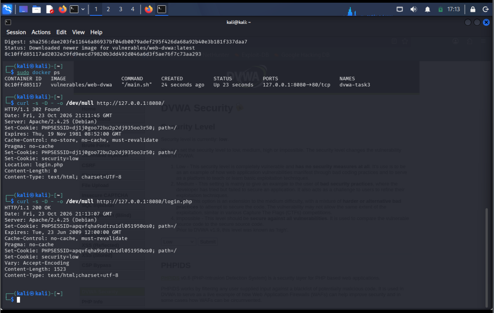
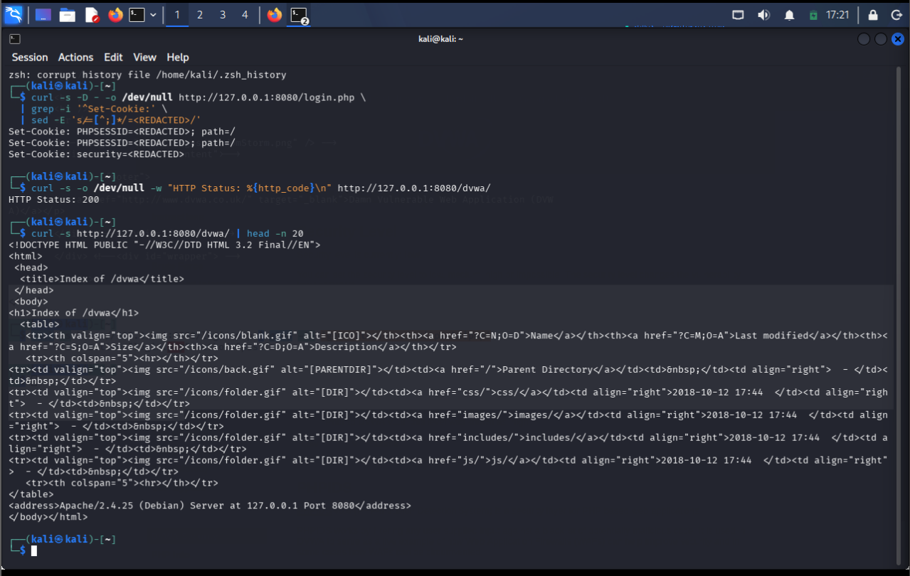
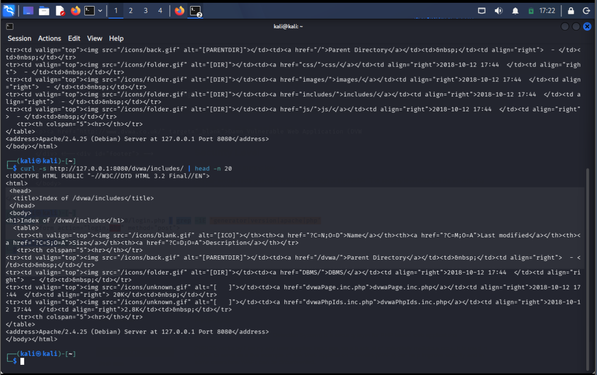
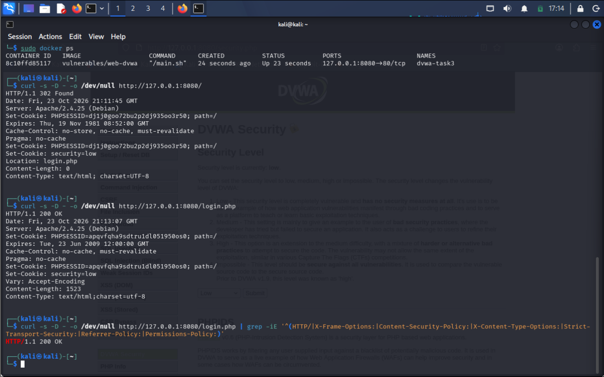
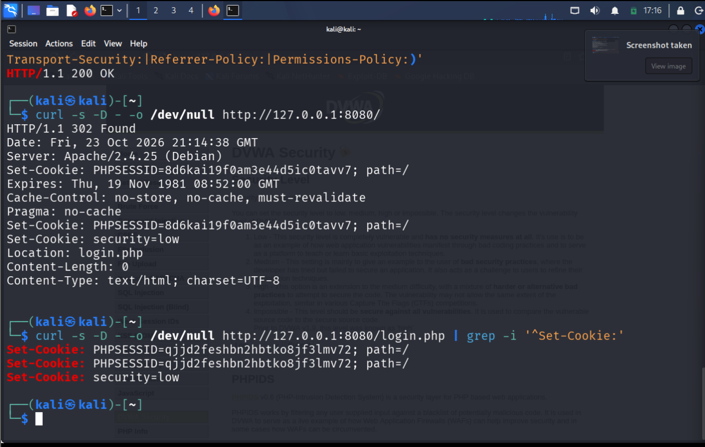

# Web Security Review — DVWA (Damn Vulnerable Web Application)

**Author:** Rakesh Babriya
**Program:** SWYNEX Cyber Security Internship, Task 3: Web Security Review
**Target:** DVWA (`http://127.0.0.1:8080`)
**Environment:** Isolated local lab (VMware + Kali Linux + Docker)
**Assessment Type:** Limited, non-destructive web security configuration review
**Date:** _24-10-2026_

---

## Table of Contents

1. [Executive Summary](#1-executive-summary)
2. [Scope and Environment](#2-scope-and-environment)
3. [Methodology and Rating Approach](#3-methodology-and-rating-approach)
4. [Findings](#4-findings)
5. [Risk Summary and Fix Priority](#5-risk-summary-and-fix-priority)
6. [Supporting Evidence](#6-supporting-evidence)
7. [Remediation and Verification Plan](#7-remediation-and-verification-plan)
8. [Limitations](#8-limitations)
9. [Conclusion](#9-conclusion)
10. [References](#10-references)

---

## 1. Executive Summary

A limited security configuration review was performed on **DVWA**, an intentionally vulnerable web application, running in an isolated and authorized local lab. `curl` was used to inspect HTTP responses, cookie attributes, and directory paths served by the web server.

**Three configuration weaknesses** were documented. All three are about missing hardening, not about a proven exploit.

| # | Finding | Where | Preliminary severity | Confidence |
|---|---------|-------|----------------------|------------|
| 1 | Directory Listing Enabled | `/dvwa/`, `/dvwa/includes/` | Low to Medium | High |
| 2 | Selected HTTP Security Headers Missing | `/login.php` response | Low to Medium | High |
| 3 | Session Cookie Attributes Not Observed | `Set-Cookie` from `/login.php` | Low to Medium | High |

All fixes are simple server or application settings. The root redirect to `login.php` is kept as context only and is not a finding.

> These results apply only to an intentionally vulnerable training application on `127.0.0.1:8080`. They say nothing about any external or production system. Severity ratings are preliminary and depend on the deployment context.

---

## 2. Scope and Environment

| Item | Details |
|------|---------|
| Target | DVWA at `http://127.0.0.1:8080` |
| Endpoints | `/`, `/login.php`, `/dvwa/`, `/dvwa/includes/`, `/security.php` |
| Testing host | Kali Linux in VMware |
| Deployment | Docker-hosted local training application |
| Tool | `curl` |
| Testing type | Non-destructive HTTP requests; no exploitation; no authenticated testing |
| Authorization | Self-owned, intentionally vulnerable lab |
| Out of scope | Any external, third-party, or production system |

---

## 3. Methodology and Rating Approach

```text
Request -> Inspect response -> Compare with expected hardening
        -> Capture evidence -> Redact -> Rate -> Recommend
```

1. Requested the application root and recorded its redirect to `login.php`.
2. Inspected the login response and checked for selected security headers.
3. Examined `Set-Cookie` headers, then redacted cookie values in the saved evidence.
4. Requested `/dvwa/` and `/dvwa/includes/` and inspected the returned directory indexes.
5. Matched each observation to a screenshot and wrote a mitigation.

Example commands (use only on your own lab):

```bash
curl -I http://127.0.0.1:8080/
curl -sI http://127.0.0.1:8080/login.php | grep -iE "x-frame-options|content-security-policy|x-content-type-options|strict-transport-security|referrer-policy|permissions-policy"
curl -sI http://127.0.0.1:8080/login.php | grep -i set-cookie
curl -s http://127.0.0.1:8080/dvwa/ | head
```

**How severity was chosen.** Each finding is rated by what the evidence shows, not by what could theoretically happen.

| Factor | Question asked |
|--------|----------------|
| Evidence | Does the screenshot directly show the weakness? |
| Exploit proof | Was an actual attack demonstrated? (No, so ratings stay at Low to Medium.) |
| Context | Is the app local HTTP or a real HTTPS deployment? |
| Exposure | What could a visitor learn or do because of it? |



*Evidence 1: Root request returns a redirect to `login.php`. Context only, not a vulnerability.*

---

## 4. Findings

### Finding 01 — Directory Listing Enabled

| Property | Value |
|----------|-------|
| **Preliminary severity** | Low to Medium, depending on exposure and sensitivity of listed files |
| **Confidence** | High |
| **Affected components** | `/dvwa/` and `/dvwa/includes/` |
| **Reference CWE** | CWE-548: Exposure of Information Through Directory Listing |

**Observation**

Requests to `/dvwa/` and `/dvwa/includes/` returned Apache-generated directory index pages. The output listed folders and files, including `css/`, `images/`, `includes/`, `js/`, `dvwaPage.inc.php`, and `dvwaPhpIds.inc.php`.

**Evidence**



*Evidence 4: Directory index returned for `/dvwa/`.*



*Evidence 5: Directory index returned for `/dvwa/includes/`.*

**Why it matters**

A directory listing shows the application structure and file names to any visitor. This makes reconnaissance easier and could expose sensitive files if they exist in a listed folder.

**What the evidence does not prove**

The screenshots show that names are listed. They do not show that PHP source code can be downloaded or that any secret was exposed.

**Recommendation**

Turn off directory indexing and keep internal files out of public reach. For Apache:

```apache
Options -Indexes
```

The server should then return a normal page or `403 Forbidden`, not a file list.

---

### Finding 02 — Selected HTTP Security Headers Missing

| Property | Value |
|----------|-------|
| **Preliminary severity** | Low to Medium, depending on the application and threat model |
| **Confidence** | High for the headers checked in the captured response |
| **Affected component** | `/login.php` response |
| **Reference CWE** | CWE-693: Protection Mechanism Failure; CWE-1021 for anti-framing |

**Observation**

The response returned `HTTP/1.1 200 OK`. The header filter showed none of: `X-Frame-Options`, `Content-Security-Policy`, `X-Content-Type-Options`, `Strict-Transport-Security`, `Referrer-Policy`, `Permissions-Policy`.

This shows the headers were absent from **that response as tested**. It does not prove every response omits them.

**Evidence**



*Evidence 2: `HTTP/1.1 200 OK` with no output for the security-header filter.*

**Why it matters**

| Missing header | Protection lost |
|----------------|-----------------|
| `X-Frame-Options` / CSP `frame-ancestors` | Page can be framed, which allows clickjacking |
| `Content-Security-Policy` | Fewer limits on where scripts and content load from |
| `X-Content-Type-Options` | Browsers may MIME-sniff in some cases |
| `Referrer-Policy`, `Permissions-Policy` | Less control over referrer data and browser features |

**Context note**

The lab runs on plain HTTP at localhost. HSTS is meant for HTTPS, so its absence here is not treated as a standalone production finding.

**Recommendation**

Set the headers on all relevant responses. For Apache with `mod_headers`:

```apache
Header always set X-Frame-Options "SAMEORIGIN"
Header always set X-Content-Type-Options "nosniff"
Header always set Referrer-Policy "strict-origin-when-cross-origin"
Header always set Permissions-Policy "geolocation=(), camera=(), microphone=()"
Header always set Content-Security-Policy "default-src 'self'"
```

The CSP above is only a starting point. Tune it to the application's real scripts, styles, and images, and test that pages still work.

---

### Finding 03 — Session Cookie Attributes Not Observed

| Property | Value |
|----------|-------|
| **Preliminary severity** | Low to Medium; confirm behaviour and deployment context |
| **Confidence** | High for the attributes visible in the captured response |
| **Affected component** | Cookies returned by `/login.php` |
| **Reference CWE** | CWE-1004 (HttpOnly), CWE-614 (Secure), CWE-1275 (SameSite) |

**Observation**

The response set cookies named `PHPSESSID` and `security`. In the captured output, the cookie directives did not include `HttpOnly`, `Secure`, or `SameSite`. Cookie values are redacted in the evidence.

**Evidence**



*Evidence 3: `Set-Cookie` output with cookie values redacted.*

**Why it matters**

| Missing attribute | Protection lost |
|-------------------|-----------------|
| `HttpOnly` | Scripts in the page could read the cookie if an injection flaw exists |
| `Secure` | The cookie can be sent over unencrypted HTTP |
| `SameSite` | Weaker limits on cross-site cookie sending, which can raise CSRF exposure |

**What the evidence does not prove**

The screenshot does not show that an exploitable XSS or CSRF flaw exists.

**Recommendation**

For a production HTTPS deployment, harden session cookies. In PHP:

```ini
session.cookie_httponly = 1
session.cookie_secure   = 1
session.cookie_samesite = Lax
```

Use `Lax` unless the application's flow needs another value. Review the `security` cookie separately to decide whether it must be readable by the client, and keep sensitive state out of client-controlled cookies.

---

## 5. Risk Summary and Fix Priority

| Priority | Finding | Effort | Reason |
|----------|---------|--------|--------|
| 1 | Directory Listing Enabled | Very low (one setting) | Quick win; removes easy reconnaissance |
| 2 | Selected Security Headers Missing | Low to medium | Adds browser-side protection; CSP needs tuning |
| 3 | Session Cookie Attributes | Low | Most useful on an HTTPS deployment |

**Overall assessment:** 3 Low-to-Medium configuration weaknesses. No exploit was attempted, and no confirmed exploitable vulnerability is claimed.

---

## 6. Supporting Evidence

| Evidence file | What it demonstrates | Used for |
|---------------|----------------------|----------|
| `evidence/01-initial-http-response.png` | Root request returns `302 Found` and redirects to `login.php` | Context only |
| `evidence/02-login-security-headers.png` | `HTTP/1.1 200 OK`, no output for the security-header filter | Finding 02 |
| `evidence/03-session-cookie-attributes-redacted.png` | Redacted `Set-Cookie` output with visible directives | Finding 03 |
| `evidence/04-directory-listing.png` | Directory index for `/dvwa/` | Finding 01 |
| `evidence/05-includes-directory-listing.png` | Directory index for `/dvwa/includes/` | Finding 01 |

Session identifiers and cookie values are redacted in the evidence.

---

## 7. Remediation and Verification Plan

| Step | Action | Expected result after the fix |
|------|--------|-------------------------------|
| 1 | Disable directory indexing, then re-request `/dvwa/` and `/dvwa/includes/` | A normal page or `403 Forbidden`, no file list |
| 2 | Add the security headers, then repeat the header `curl` check | All selected headers appear in the response |
| 3 | Harden cookie attributes for HTTPS, then inspect `Set-Cookie` again | `HttpOnly`, `Secure`, and `SameSite` are present |
| 4 | Save new screenshots of the re-tests | Before and after evidence for each finding |

---

## 8. Limitations

- A limited configuration review of a local, intentionally vulnerable training application.
- Findings come from the specific endpoints and responses tested. Other routes and methods may behave differently.
- No authenticated assessment, exploit validation, source-code review, or production impact analysis was done.
- Risk ratings are preliminary and are not a formal CVSS score.
- Apache version disclosure was seen but is not reported as a standalone vulnerability, because disclosure alone does not show exploitable risk.

---

## 9. Conclusion

The evidence supports documenting directory listing, missing selected HTTP security headers, and missing cookie-hardening attributes as configuration weaknesses in the local DVWA lab. The root redirect is context only.

Each finding has evidence, an honest statement of what it does and does not prove, and a clear fix. The next step is to apply the fixes, repeat the same checks, and update this report with verified results before calling any item remediated.

---

## 10. References

- [OWASP Secure Headers Project](https://owasp.org/www-project-secure-headers/)
- [OWASP Session Management Cheat Sheet](https://cheatsheetseries.owasp.org/cheatsheets/Session_Management_Cheat_Sheet.html)
- [Apache HTTP Server: `Options` directive](https://httpd.apache.org/docs/2.4/mod/core.html#options)
- [CWE-548: Exposure of Information Through Directory Listing](https://cwe.mitre.org/data/definitions/548.html)
- [CWE-1004: Sensitive Cookie Without 'HttpOnly' Flag](https://cwe.mitre.org/data/definitions/1004.html)
- [CWE-614: Sensitive Cookie in HTTPS Session Without 'Secure' Attribute](https://cwe.mitre.org/data/definitions/614.html)
- [CWE-1275: Sensitive Cookie with Improper SameSite Attribute](https://cwe.mitre.org/data/definitions/1275.html)
- [CWE-693: Protection Mechanism Failure](https://cwe.mitre.org/data/definitions/693.html)
- [CWE-1021: Improper Restriction of Rendered UI Layers](https://cwe.mitre.org/data/definitions/1021.html)

---

**Disclaimer:** This report is for educational purposes and records testing of a local, authorized training environment only. Test only systems you own or have explicit permission to assess.
